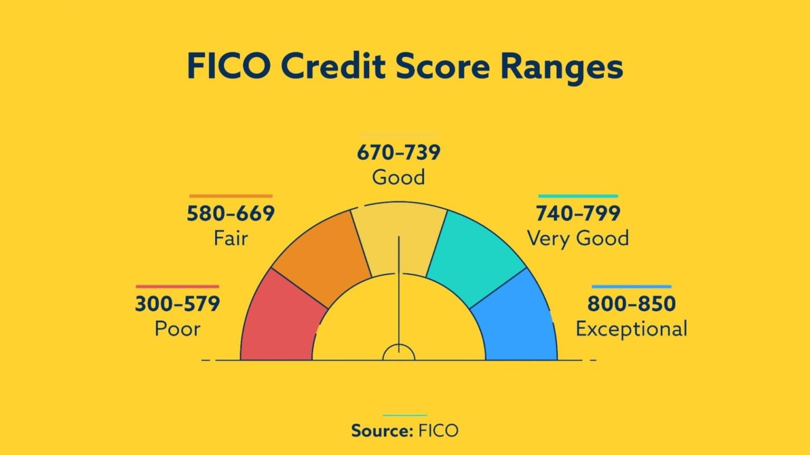



```{=html}
<style>
.mcq { border: 1px solid #ccc; border-left: 6px solid #003300; border-radius: 6px; padding: 0.8em 1em; margin: 1.2em 0; background: #f7faf7; }
.mcq-title { font-weight: bold; color: #003300; margin-bottom: 0.4em; }
.mcq-opt { display: block; width: 100%; text-align: left; margin: 0.35em 0; padding: 0.45em 0.7em; border: 1px solid #bbb; border-radius: 4px; background: white; cursor: pointer; font-size: 0.95em; }
.mcq-opt:hover { background: #eef5ee; }
.mcq-opt.right { background: #d9f2d9; border-color: #2e7d32; }
.mcq-opt.wrong { background: #fde2dd; border-color: #f15a31; }
.mcq-feedback { margin-top: 0.6em; font-size: 0.95em; }
</style>
<script>
document.addEventListener("click", function (e) {
  var btn = e.target.closest(".mcq-opt");
  if (!btn) return;
  var box = btn.closest(".mcq");
  box.querySelectorAll(".mcq-opt").forEach(function (b) { b.classList.remove("right", "wrong"); });
  var correct = btn.dataset.correct === "true";
  btn.classList.add(correct ? "right" : "wrong");
  box.querySelector(".mcq-feedback").innerHTML =
    (correct ? "<strong>Correct!</strong> " : "<strong>Not quite.</strong> ") + btn.dataset.feedback;
});
</script>
```

```{r}
#| echo: false
#| warning: false
#| message: false
library(tidyverse)
library(tidymodels)
library(ggformula)
library(patchwork)
theme_set(theme_minimal(base_size = 14))
```

::: callout-important
## Today's plan

I've lost my voice! 🫠 Instead of a lecture, you'll work through this tutorial with your group at your own pace. It covers the same material as the [Day 19 slides](../slides/slides19.qmd) and the [Day 19 activity](19-binary-logistic.qmd).

- **Code chunks:** you can use these as usual
- **Check-in questions:** click an answer to see whether you're right (and why). Try to answer *before* you click!
- **Numbered questions (Q1, Q2, ...):** remember write your answers in your notes.

I will wander around and be here to answer any questions you have! 
:::

# Part 0: What we've done so far

## 1. SLR: Quantitative outcome and one quantitative predictor

```{r}
#| echo: false
movies <- read.csv("https://aloy.github.io/stat230-materials/data/movie_scores.csv")

gf_point(audience ~ critics, data = movies) |>
  gf_lm()
```

## 2. MLR: Quantitative outcome with quantitative and categorical predictors:

```{r}
#| echo: false
fev <- read.table("https://aloy.github.io/stat230-materials/data/FEVdataAge10to19.txt", sep = "\t", header = TRUE) |>
  mutate(Smoke = factor(Smoke, levels = c(0, 1), labels = c("Nonsmoker", "Smoker")))

mod_parallel <- lm(FEV ~ Age + Smoke, data = fev)
mod_diff_slope <- lm(FEV ~ Age + Age:Smoke, data = fev)
mod_separate <- lm(FEV ~ Age * Smoke, data = fev)

fev_fit_plot <- function(mod) {
  ggplot(augment(mod, data = fev), aes(x = Age, y = FEV, color = Smoke, shape = Smoke)) +
    geom_point(alpha = 0.5) +
    geom_line(aes(y = .fitted), linewidth = 1) +
    scale_color_manual(values = c("#f15a31", "#000036")) +
    labs(y = "FEV (in L/s)") + 
    theme(legend.position = "bottom")
}

fev_fit_plot(mod_parallel) + fev_fit_plot(mod_separate)

```

## 3. Today: a **binary** outcome

```{r}
#| label: cartoon-settings
#| message: false
#| echo: false
set.seed(8675309)
n <- 50
x <- rnorm(n, mean = 0, sd = 1)
b0 <- 0
b1 <- 5
prob <- 1 / (1 + exp(-(b0 + b1 * x)))
y <- rbinom(n, 1, prob)
df <- tibble(x = x, y = as.factor(y))

df_fit <- logistic_reg() |>
  fit(y ~ x, data = df)

new_df_aug <- augment(
  df_fit,
  new_data = tibble(x = seq(1.2 * min(x), 1.2 * max(x), length.out = 500))
)
```

$$
y = 
\begin{cases}
1 & \text{eg. Yes, Win, True, Heads, Success}\\
0 & \text{eg. No, Lose, False, Tails, Failure}
\end{cases}
$$

```{r}
#| label: binary-outcome-scatter
#| message: false
#| echo: false
#| fig-width: 10
ggplot(df, aes(x = x, y = y)) +
  geom_point(alpha = 0.5) +
  theme_minimal(base_size = 24)
```

If we can model the relationship between predictors ($x$) and a binary outcome ($y$), we can use the model to do a special kind of prediction called *classification*.

### Example: Is the e-mail spam or not? 

$$
\mathbf{x}: \text{word and character counts in an e-mail.}
$$

{fig-align="center" width="70%"}

$$
y
= 
\begin{cases}
1 & \text{it's spam}\\
0 & \text{it's legit}
\end{cases}
$$

### Example: Is it cancer or not?

$$
\mathbf{x}: \text{features in a medical image.}
$$

{fig-align="center"}

$$
y
= 
\begin{cases}
1 & \text{it's cancer}\\
0 & \text{it's healthy}
\end{cases}
$$

### Example: Will they default?

$$
\mathbf{x}: \text{financial and demographic info about a loan applicant.}
$$

{fig-align="center" width="60%"}

$$
y
= 
\begin{cases}
1 & \text{applicant is at risk of defaulting on loan}\\
0 & \text{applicant is safe}
\end{cases}
$$

### Modeling probabilities instead of responses 

This data is hard to model! Instead of modeling $y$ directly, we model the **probability** that $y=1$:

```{r}
#| message: false
#| echo: false
#| fig-asp: 0.4
ggplot(df, aes(x = x, y = as.numeric(y) - 1)) +
  geom_point(alpha = 0.5) +
  geom_line(
    data = new_df_aug,
    aes(y = .pred_1),
    color = "#d1805f",
    linewidth = 1.5
  ) +
  theme_minimal(base_size = 24) +
  scale_y_continuous(
    limits = c(-0.1, 1.1),
    breaks = c(0, 1),
    minor_breaks = NULL
  ) +
  labs(y = "y")
```

So, our prediction questions turn into: 

-   "Given new email, what's the probability that it's spam?''
-   "Given new image, what's the probability that it's cancer?''
-   "Given new loan application, what's the probability that they default?''

Why don't we model y directly?

-   **Recall regression with a numerical outcome**:

    -   Our models do not output *guarantees* for $y$, they output predictions that describe behavior *on average*

-   **Similar when modeling a binary outcome**:

    -   Our models cannot directly guarantee that $y$ will be zero or one. The correct analog to "on average" for a 0/1 outcome is "what's the probability?"

Today, we'll work through an example with the goal of predicting whether an article is fake news or not.

# Part 1: The data

This data set has information on 150 news articles, some that are real and some that are fake. Our goal is to build a statistical model to explain `type` based on features of the article.

- `type`: "real" or "fake" / `type_num`: 0 (real) or 1 (fake)
- `title` and `url` of article
- `title_words`: how many words in the title
- `title_has_excl`: whether title has an exclamation point
- `title_caps_percent`: percent of title in capital letters
- `negative`: percent of words that have negative sentiment
- `positive`: percent of words that have positive sentiment

Run the code chunk below to load the data. (Every chunk after this one needs `news`, so start here!)

```{webr}
#| autorun: true
library(ggformula)
news <- read.csv("https://aluby.github.io/stat230/data/fake_news_bayesrules.csv")
head(news[, c("type", "type_num", "title_has_excl", "title_caps_percent", "title_words")])
```

```{=html}
<div class="mcq">
  <div class="mcq-title">Check-in 1</div>
  <p>Before we model anything: what does <code>type_num = 1</code> mean?</p>
  <button class="mcq-opt" data-correct="false" data-feedback="Look at the first few rows: the articles with <code>type = &quot;fake&quot;</code> have <code>type_num = 1</code>.">A. The article is real</button>
  <button class="mcq-opt" data-correct="true" data-feedback="A &quot;success&quot; (Y = 1) is a fake article. Always check how your response is coded before modeling! Everything today is about the probability (and odds) of an article being <em>fake</em>.">B. The article is fake</button>
  <button class="mcq-opt" data-correct="false" data-feedback="That's <code>title_has_excl</code>. <code>type_num</code> is the response variable.">C. The title has an exclamation point</button>
  <div class="mcq-feedback"></div>
</div>
```

**Q1.** Before we do anything else, how do you think `title_has_excl` and `title_caps_percent` are related to `type_num`? (Write your answer down in your notes)


# Part 2: Probability, odds, and odds ratios

## Probability vs. odds

If $\pi$ is the probability of an event, then the **odds** of the event are

$$\text{odds} = \frac{\pi}{1 - \pi} = \frac{P(\text{event})}{P(\text{not event})}$$

| Probability $\pi$ | Odds $\pi/(1-\pi)$ | How we'd say it |
|:--|:--|:--|
| 0.5 | 1 | "even odds" |
| 0.75 | 3 | "3 to 1" |
| 0.2 | 0.25 | "1 to 4" |

Probabilities live between 0 and 1. Odds live between 0 and $\infty$.

## Fake news and exclamation points

Here's a table of article type by whether the title has an exclamation point:

```{webr}
table(news$title_has_excl, news$type) |>
  addmargins()
```

For titles **with** an exclamation point (the `TRUE` row):

- $P(\text{fake} \mid \text{exclamation}) = 16/18 \approx 0.889$
- $\text{Odds}(\text{fake} \mid \text{exclamation}) = \dfrac{16/18}{2/18} = \dfrac{16}{2} = 8$

Notice the shortcut: the odds are just (number fake) / (number real). You can use the chunk below as a calculator.

```{webr}
16 / 18   # probability
16 / 2    # odds
```

```{=html}
<div class="mcq">
  <div class="mcq-title">Check-in 2</div>
  <p>What are the odds that an article is fake, for titles <strong>without</strong> an exclamation point?</p>
  <button class="mcq-opt" data-correct="false" data-feedback="44/132 = 0.333 is the <em>probability</em> of fake. The odds compare fake to real: 44/88.">A. 0.333</button>
  <button class="mcq-opt" data-correct="true" data-feedback="Odds = (number fake) / (number real) = 44/88 = 0.5. Equivalently, (1/3)/(2/3) = 0.5. A fake article without an exclamation point is half as likely as a real one.">B. 0.5</button>
  <button class="mcq-opt" data-correct="false" data-feedback="88/44 = 2 are the odds of being <em>real</em>. Make sure &quot;fake&quot; is on top.">C. 2</button>
  <button class="mcq-opt" data-correct="false" data-feedback="44 is a count, not odds. Odds compare the number fake to the number real.">D. 44</button>
  <div class="mcq-feedback"></div>
</div>
```

## Odds ratios

To compare the two groups, we divide their odds. This is the **odds ratio (OR)**:

$$OR = \frac{\text{Odds}(\text{fake} \mid \text{exclamation})}{\text{Odds}(\text{fake} \mid \text{no exclamation})} = \frac{8}{0.5} = 16$$

```{=html}
<div class="mcq">
  <div class="mcq-title">Check-in 3</div>
  <p>Which is the correct interpretation of OR = 16?</p>
  <button class="mcq-opt" data-correct="false" data-feedback="This is the most common mistake! &quot;16 times as likely&quot; is a statement about <em>probabilities</em>. The probability ratio is 0.889/0.333 = 2.67, which is very different from 16.">A. Articles with an exclamation point in the title are 16 times as likely to be fake.</button>
  <button class="mcq-opt" data-correct="true" data-feedback="An odds ratio compares <em>odds</em>, so the interpretation has to be about odds.">B. The odds of being fake are 16 times as high for articles with an exclamation point in the title as for articles without one.</button>
  <button class="mcq-opt" data-correct="false" data-feedback="16 is a ratio (a multiplier), not a difference.">C. The probability of being fake is 16 percentage points higher for articles with an exclamation point in the title.</button>
  <div class="mcq-feedback"></div>
</div>
```

**Q2.** What would an odds ratio of exactly 1 mean in this context? What about an odds ratio less than 1?

# Part 3: Why not linear regression?

Now let's use a quantitative predictor: `title_caps_percent`. Here's what happens if we fit our usual linear regression model to a 0/1 response. We'll treat $\hat y$ as the probability of a 1. 

```{webr}
gf_jitter(type_num ~ title_caps_percent, data = news, width = 0.2, height = 0.05) |>
  gf_lm(color = "#f15a31") |>
  gf_labs(y = "Fake = 1")

lm_fit <- lm(type_num ~ title_caps_percent, data = news)
predict(lm_fit, newdata = data.frame(title_caps_percent = c(0, 43.75)))
```

```{=html}
<div class="mcq">
  <div class="mcq-title">Check-in 4</div>
  <p>The linear model predicts 1.17 for a title that is 43.75% capital letters (the largest value in the data). What's the problem?</p>
  <button class="mcq-opt" data-correct="true" data-feedback="A probability can't be bigger than 1 (or less than 0), but a straight line keeps going forever. That's why we need a model with a different shape.">A. The response is a probability, and the line predicts values above 1.</button>
  <button class="mcq-opt" data-correct="false" data-feedback="A large slope isn't the problem. The issue is the <em>shape</em> of the model: a line can go outside the range [0, 1].">B. The slope is too large.</button>
  <button class="mcq-opt" data-correct="false" data-feedback="More data won't fix it: any line with a nonzero slope eventually goes above 1 or below 0.">C. We need more data.</button>
  <div class="mcq-feedback"></div>
</div>
```

# Part 4: The logistic regression model

The trick is to model a version of the probability that isn't stuck between 0 and 1: the **log-odds** (also called the **logit**).

$$\log\left(\frac{\pi(x)}{1-\pi(x)}\right) = \beta_0 + \beta_1 x_1 + \beta_2 x_2 + \cdots + \beta_p x_p$$

where $\pi(x) = P(Y = 1 \mid x)$.

| Scale | Formula | Range |
|:--|:--|:--|
| Probability | $\pi$ | 0 to 1 |
| Odds | $\dfrac{\pi}{1-\pi}$ | 0 to $\infty$ |
| Log-odds | $\log\left(\dfrac{\pi}{1-\pi}\right)$ | $-\infty$ to $\infty$ |

Because the log-odds can be any number, it's OK for the right-hand side to be a line.

```{=html}
<div class="mcq">
  <div class="mcq-title">Check-in 5</div>
  <p>In logistic regression, the response is a <strong>linear</strong> function of the predictors on which scale?</p>
  <button class="mcq-opt" data-correct="false" data-feedback="If the probability were linear in x, we'd be back to the problem in Part 3.">A. Probability</button>
  <button class="mcq-opt" data-correct="false" data-feedback="Close! The odds are an <em>exponential</em> function of x. We have to take one more step (the log).">B. Odds</button>
  <button class="mcq-opt" data-correct="true" data-feedback="The log-odds (logit) is linear in the predictors. To talk about odds or probabilities, we have to transform back.">C. Log-odds</button>
  <div class="mcq-feedback"></div>
</div>
```

## Fitting the model in R

We use `glm()` with `family = binomial`. The syntax is otherwise the same as `lm()`.

```{webr}
news_glm <- glm(type_num ~ title_caps_percent, data = news, family = binomial)
coef(news_glm)
```

So the fitted model is

$$\log\left(\frac{\widehat\pi(x)}{1-\widehat\pi(x)}\right) = -0.932 + 0.098 x$$

where $x$ is `title_caps_percent`. 

# Part 5: Interpreting $\widehat\beta_1$

$\widehat\beta_1 = 0.098$ is the expected change in the **log-odds** of being fake for a 1-unit increase in `title_caps_percent`. But we don't think in log-odds! Exponentiating both sides gives the odds:

$$\widehat{\text{odds}}(x) = e^{\widehat\beta_0 + \widehat\beta_1 x} = e^{\widehat\beta_0} \, e^{\widehat\beta_1 x}$$

If $x$ increases by 1, the odds get *multiplied* by

$$\frac{\widehat{\text{odds}}(x + 1)}{\widehat{\text{odds}}(x)} = \frac{e^{\widehat\beta_0} e^{\widehat\beta_1 (x+1)}}{e^{\widehat\beta_0} e^{\widehat\beta_1 x}} = e^{\widehat\beta_1}$$

So $e^{\widehat\beta_1}$ is an **odds ratio**.

```{webr}
exp(coef(news_glm))
```

```{=html}
<div class="mcq">
  <div class="mcq-title">Check-in 6</div>
  <p>Which is the correct interpretation of the slope?</p>
  <button class="mcq-opt" data-correct="false" data-feedback="0.098 is a change in the <em>log-odds</em>, not the probability. In logistic regression, the change in probability isn't constant: it depends on x.">A. For each additional percentage point of capital letters, the probability of fake news increases by 0.098.</button>
  <button class="mcq-opt" data-correct="false" data-feedback="On the odds scale the change is <em>multiplicative</em>, so we use e<sup>0.098</sup>, not 0.098.">B. For each additional percentage point of capital letters, the odds of fake news increase by 0.098.</button>
  <button class="mcq-opt" data-correct="true" data-feedback="e<sup>0.098</sup> &asymp; 1.10, so the odds increase by about 10% for each additional percentage point of capital letters in the title.">C. For each additional percentage point of capital letters, the odds of fake news are multiplied by about 1.10.</button>
  <button class="mcq-opt" data-correct="false" data-feedback="1.10 multiplies the <em>odds</em>, not the probability.">D. For each additional percentage point of capital letters, the probability of fake news is multiplied by about 1.10.</button>
  <div class="mcq-feedback"></div>
</div>
```

```{=html}
<div class="mcq">
  <div class="mcq-title">Check-in 7</div>
  <p>What happens to the odds of fake news if the percent of capital letters increases by <strong>10</strong> percentage points? (You can use the chunk above as a calculator.)</p>
  <button class="mcq-opt" data-correct="false" data-feedback="Odds ratios multiply; they don't add. Each 1-point increase multiplies the odds by 1.10, so 10 increases multiply them by 1.10 ten times.">A. The odds are multiplied by 10 &times; 1.10 = 11.0</button>
  <button class="mcq-opt" data-correct="false" data-feedback="0.977 is the change in the <em>log-odds</em> (10 &times; 0.098). Exponentiate to get to the odds scale.">B. The odds increase by 10 &times; 0.098 = 0.977</button>
  <button class="mcq-opt" data-correct="true" data-feedback="e<sup>10 &times; 0.0977</sup> = e<sup>0.977</sup> &asymp; 2.66. (This is the same as 1.1027<sup>10</sup>.) The odds are about 2.66 times as high.">C. The odds are multiplied by e<sup>10 &times; 0.0977</sup> &asymp; 2.66</button>
  <div class="mcq-feedback"></div>
</div>
```

# Part 6: From log-odds to probabilities

What's the probability that an article with **20%** capital letters in the title is fake? Work from the inside out:

1. **Log-odds:** $\widehat\eta = -0.932 + 0.098(20) \approx 1.023$
2. **Odds:** $\widehat\omega = e^{\widehat\eta} = e^{1.023} \approx 2.78$
3. **Probability:** $\widehat\pi = \dfrac{\widehat\omega}{1 + \widehat\omega} = \dfrac{e^{\widehat\eta}}{1 + e^{\widehat\eta}} \approx 0.736$

```{webr}
b <- unname(coef(news_glm))
eta <- b[1] + b[2] * 20       # log-odds
odds <- exp(eta)              # odds
prob <- odds / (1 + odds)     # probability
c(log_odds = eta, odds = odds, prob = prob)
```

::: callout-tip
To go from odds to probability: $\pi = \dfrac{\text{odds}}{1 + \text{odds}}$. For example, odds of 3 ("3 to 1") is a probability of $3/4 = 0.75$.
:::

```{=html}
<div class="mcq">
  <div class="mcq-title">Check-in 8</div>
  <p>What is the estimated probability that an article with <strong>no</strong> capital letters in the title (x = 0) is fake? Edit the code above to check!</p>
  <button class="mcq-opt" data-correct="false" data-feedback="&minus;0.932 is the <em>log-odds</em>. Probabilities can't be negative!">A. &minus;0.932</button>
  <button class="mcq-opt" data-correct="false" data-feedback="e<sup>&minus;0.932</sup> &asymp; 0.394 is the <em>odds</em>. One more step: odds / (1 + odds).">B. 0.394</button>
  <button class="mcq-opt" data-correct="true" data-feedback="Log-odds &minus;0.932 &rarr; odds e<sup>&minus;0.932</sup> &asymp; 0.394 &rarr; probability 0.394 / 1.394 &asymp; 0.283.">C. 0.283</button>
  <button class="mcq-opt" data-correct="false" data-feedback="That would be the probability if the log-odds were 0 (odds of 1). Here the log-odds are &minus;0.932.">D. 0.5</button>
  <div class="mcq-feedback"></div>
</div>
```

## Letting R do it: `predict()`

`predict()` works for `glm()` models too, but be careful about the scale:

```{webr}
predict(news_glm, newdata = data.frame(title_caps_percent = 20))
predict(news_glm, newdata = data.frame(title_caps_percent = 20), type = "response")
```

```{=html}
<div class="mcq">
  <div class="mcq-title">Check-in 9</div>
  <p>The first line of output (without <code>type = "response"</code>) is on which scale?</p>
  <button class="mcq-opt" data-correct="false" data-feedback="It's bigger than 1, so it can't be a probability. That's the second line.">A. Probability</button>
  <button class="mcq-opt" data-correct="false" data-feedback="The odds would be e<sup>1.023</sup> &asymp; 2.78. R never gives you the odds directly.">B. Odds</button>
  <button class="mcq-opt" data-correct="true" data-feedback="By default, <code>predict()</code> gives the log-odds (the &quot;link&quot; scale). Add <code>type = &quot;response&quot;</code> to get probabilities.">C. Log-odds</button>
  <div class="mcq-feedback"></div>
</div>
```

## The fitted model on all three scales

Run the chunk below to see the same fitted model on all three scales.

```{webr}
x <- seq(0, 60, by = 0.5)
b <- coef(news_glm)
log_odds <- b[1] + b[2] * x
three_scales <- data.frame(
  x = rep(x, 3),
  value = c(log_odds, exp(log_odds), exp(log_odds) / (1 + exp(log_odds))),
  scale = rep(c("1. log-odds", "2. odds", "3. probability"), each = length(x))
)
gf_line(value ~ x, data = three_scales, color = "#003300", linewidth = 1) |>
  gf_facet_wrap(~scale, scales = "free_y") |>
  gf_labs(x = "title_caps_percent", y = "")
```

**Q3.** Describe the shape of the fitted model on each of the three scales. Why does the probability curve flatten out near 1?

# Part 7: Connecting back to odds ratios

What if the predictor is the 0/1 variable `title_has_excl`?

```{webr}
excl_glm <- glm(type_num ~ title_has_excl, data = news, family = binomial)
coef(excl_glm)
exp(coef(excl_glm))
```

```{=html}
<div class="mcq">
  <div class="mcq-title">Check-in 10</div>
  <p>Compare <code>exp(coef(excl_glm))</code> to your work in Part 2. What is e<sup>&beta;<sub>1</sub></sup> = 16?</p>
  <button class="mcq-opt" data-correct="false" data-feedback="The probability ratio was 0.889 / 0.333 = 2.67.">A. The ratio of the probabilities of fake news</button>
  <button class="mcq-opt" data-correct="true" data-feedback="It's exactly the odds ratio we computed by hand from the table! And e<sup>&beta;<sub>0</sub></sup> = 0.5 is the odds of fake news for titles <em>without</em> an exclamation point (the reference group).">B. The odds ratio from the table in Part 2</button>
  <button class="mcq-opt" data-correct="false" data-feedback="There are 16 fake articles with an exclamation point, but that's a coincidence of this data set. Here 16 is a ratio of two odds: 8 / 0.5.">C. The number of fake articles with an exclamation point</button>
  <div class="mcq-feedback"></div>
</div>
```

**Q4.** What does $e^{\widehat\beta_0} = 0.5$ represent in context?

# Part 8: Your turn

Now, fit a logistic regression model using all three variables we've discussed today (`title_has_excl`, `title_caps_percent`, and `title_words`) and report the `summary()`.

```{webr}
news_glm_2 <- glm(type_num ~ ___ + ___ + ___, data = news, family = binomial)
summary(___)
```

**Q5.** Write out the fitted model (on the log-odds scale) for articles (A) with an exclamation point in the title and (B) without an exclamation point in the title.

**Q6.** Write out interpretations for all slope coefficients in the model in terms of the **odds** of being fake news.

**Q7.** Use `predict()` to find the estimated probability that an article with an exclamation point, 10% capital letters, and 12 words in the title is fake.

```{webr}
# your code here
```

**Q8.** Based on what we know about OLS (**o**rdinary **l**east **s**quares, which includes both SLR and MLR), which predictors appear to be most important for this model?

**Q9.** What questions do you have about the `summary()` output? (Write them down! We'll talk about them next class.)

***

## Function quick reference

| Function | Purpose |
|----|-----------|
| `table(x, y) |> addmargins()` | Two-way table with row and column totals |
| `glm(formula, data, family = binomial)` | Fit a binary logistic regression model |
| `coef(model)`, `exp(coef(model))` | Coefficients on the log-odds scale; odds ratios |
| `summary(model)` | View model summary and Wald tests |
| `predict(model, newdata)` | Predictions on the log-odds scale |
| `predict(model, newdata, type = "response")` | Predictions on the probability scale |
